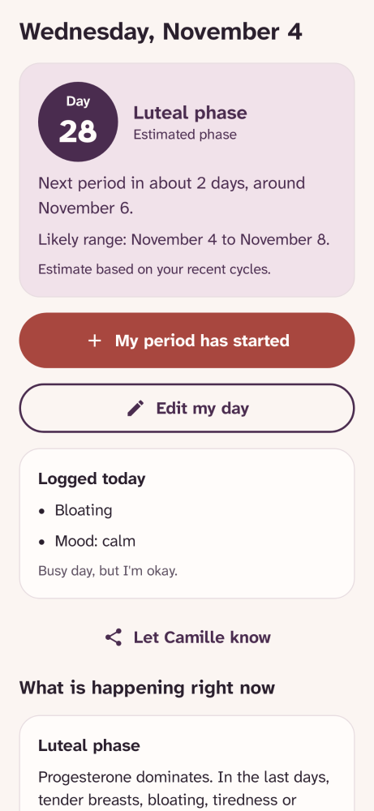
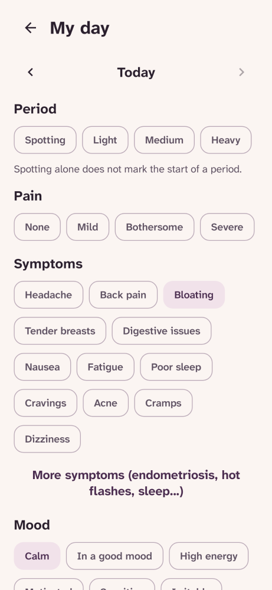
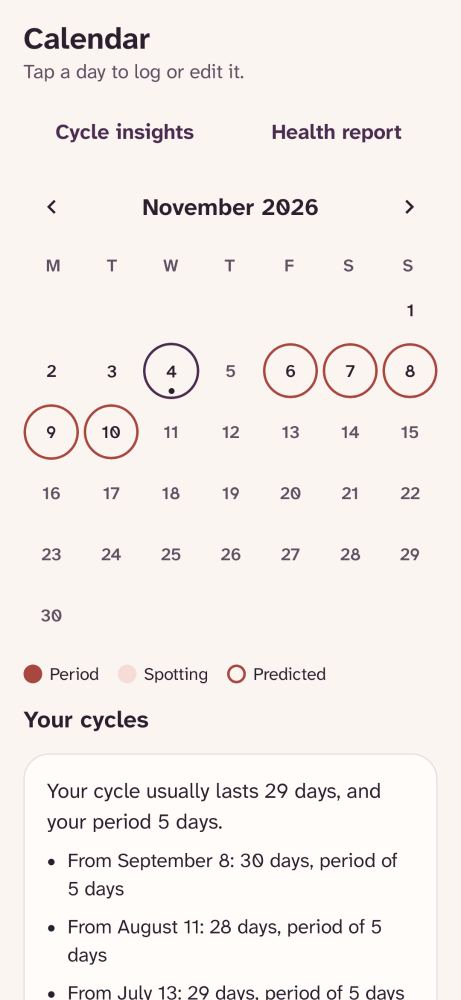
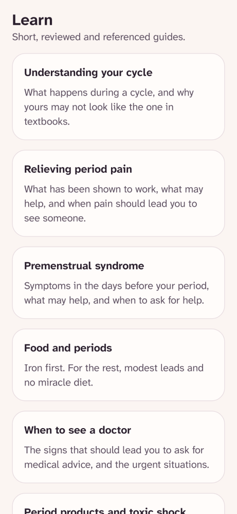
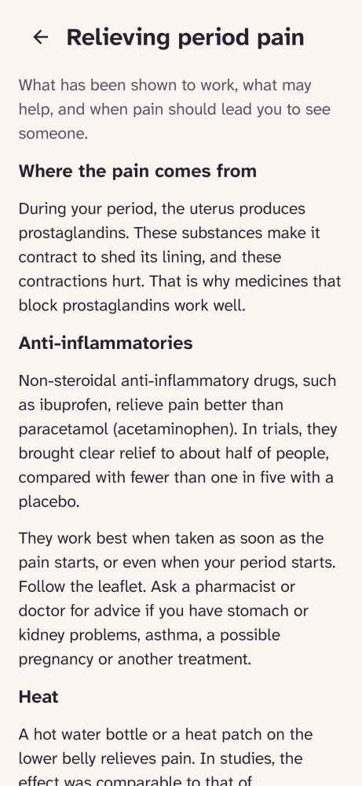
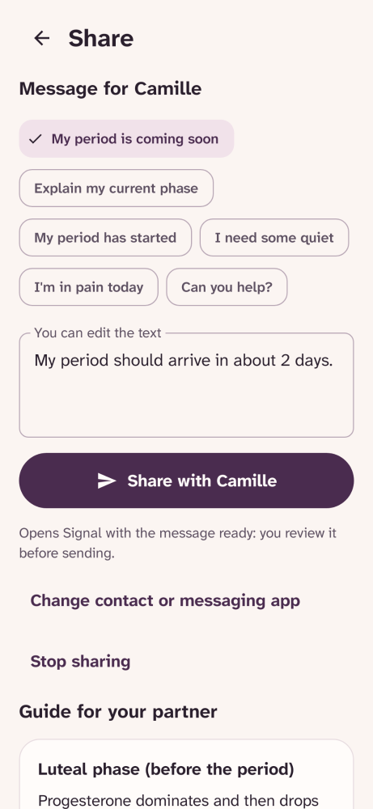
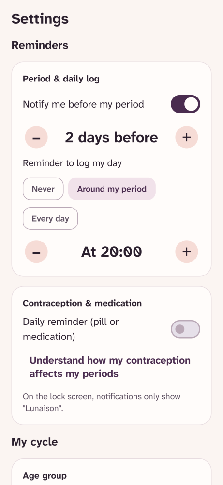
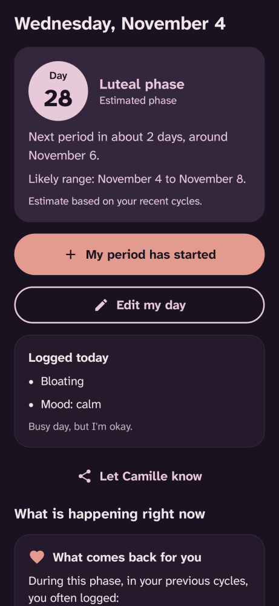
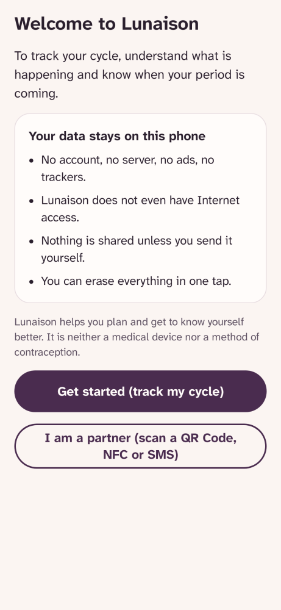

# Lunaison

[Français](README.md) · **English**

[](https://github.com/Relthdrarxash/lunaison/actions/workflows/ci.yml)

A free and open source menstrual cycle tracker, with no account. To log your periods, symptoms and mood, understand what is happening in each phase, know when your next period is coming, and let your partner know if you wish.

Lunaison is a free Android app, open source (MPL-2.0), with no ads, no trackers and **no Internet access**. Everything stays on the phone.

**[Lunaison website](https://relthdrarxash.github.io/lunaison/en/)** · **[Google Play](https://play.google.com/store/apps/details?id=fr.lunaison)** · **[Download APK](https://github.com/Relthdrarxash/lunaison/releases/latest)** · [For health professionals](https://relthdrarxash.github.io/lunaison/en/professionals.html) · [Medical evidence](https://relthdrarxash.github.io/lunaison/en/evidence.html) · [Privacy](https://relthdrarxash.github.io/lunaison/en/privacy.html)

## What the app does

- **Log your days in a few seconds**: flow, pain (described by its effect), symptoms (8 common symptoms shown by default, plus clinical symptoms for pelvic pain, endometriosis and perimenopause), moods, contraception or medication taken, optional ovulation signs (cervical mucus and keypad-free basal temperature), and a personal note. **Recent 7-day strip on home screen** to quickly view recent logs and fill in a forgotten day in one tap.
- **Forecast periods and adapt to every life stage**: an estimated date and a plausible range calculated from your last six cycles, with an option to display the estimated fertile window, a **naturally irregular cycles mode** (perimenopause, PCOS, postpartum), and a toggle to pause predictions (pregnancy, breastfeeding, continuous contraception).
- **Understand the current phase and all four phases**: what is happening in the body, what helps, and what tends to come back for you across each of the four phases based on your previous cycles.
- **Generate a one-page clinician health report**: accessible in 1 tap from Calendar or Settings. Median length and regularity of the last 6 cycles (FIGO/ACOG reference ranges), bleeding duration, moderate/severe pain days, spotting, **90-day pain and endometriosis indicators (the 5 "Ds")** and recurring symptoms, ready to show or share during a medical appointment.
- **One referenced tip a day and 1-minute guided breathing**: the daily tip changes according to the phase and responds first to what you logged; a guided abdominal breathing exercise (4 s / 6 s) helps ease cramps or premenstrual tension.
- **Spot what deserves medical advice**: repeated severe pain, periods longer than 8 days, repeated heavy periods (NHS indicators), cycles outside the usual range, bleeding between periods, missing periods, extended delay. Never a diagnosis.
- **Read referenced guides**: the cycle, pain, food, premenstrual syndrome, when to see a doctor, contraception, **endometriosis, PCOS, adenomyosis, perimenopause**, limits of forecasts, a guide for partners and family.
- **Serverless data migration & import**: direct import of backups from the popular *Period Calendar* app (password-protected ZIP or JSON) and Lunaison CSV files, parsed and decrypted locally on device without sending a single byte to any server.
- **Discreet reminders**: before your period, to log your day, or daily for contraception or medication, always neutral on the lock screen ("Lunaison").
- **Share with a partner, by message or offline QR Code** (18 and over): ready-to-send messages, concrete support tips for your partner, and serverless estimate sharing via **QR Code** (displayed and scanned right inside the app) or Android's native share menu (SMS, Signal, WhatsApp…).
- **Customization, PIN lock and home screen widget**: 4 color palettes (light and dark), optional 4-digit PIN lock (hiding the preview in recent apps), and a discreet home screen widget.

Lunaison is **neither a medical device nor a method of contraception**.

## Preview

<table>
  <tr>
    <td align="center"><br>Home</td>
    <td align="center"><br>My day</td>
    <td align="center"><br>Calendar</td>
  </tr>
  <tr>
    <td align="center"><br>Understand</td>
    <td align="center"><br>Referenced guide</td>
    <td align="center"><br>Partner sharing</td>
  </tr>
  <tr>
    <td align="center"><br>Settings</td>
    <td align="center"><br>Dark theme</td>
    <td align="center"><br>Welcome</td>
  </tr>
</table>

Screenshots are generated automatically from the screen code on every change.

## Design commitments

- **No Internet permission**: the app requests no network access from Android. Your period dates, symptoms and notes stay on your phone.
- **Everything included upfront**: perimenopause mode, consultation summaries, ovulation signs and partner sharing are all available with no subscription.
- **A calm tone, with no red warnings**: an extended delay or unusual symptom is explained plainly with its medical references.
- **No daily streak counter**: skipping a few days is normal and does not stop the app from working.

## Why Lunaison is free

Lunaison grew out of my partner's need: to track her cycle more easily, and to let me support her day to day. Existing apps often keep their useful features behind a subscription, or fund themselves with their users' data, even though it is some of the most intimate data there is. Lunaison does the opposite: it is free, open source, works without the Internet and keeps everything on the phone.

The app sticks to what is necessary. What it does not say itself, where its reference ranges come from and why it is built this way, is explained in [What the studies say](https://relthdrarxash.github.io/lunaison/en/evidence.html).

## Privacy

- No Internet permission, no third-party SDK, no account.
- Cloud backup turned off: health data never passes through any server. Direct device-to-device transfer (Android 12+) is supported, along with spreadsheet CSV export and **direct backup import (Lunaison CSV or password-protected Period Calendar archives)**, processed 100% locally.
- The system contact picker gives access only to the chosen contact, with no permission on the address book.
- Complete erasure in one tap.

## Technical details

Kotlin, Jetpack Compose, Material 3, Room, WorkManager. minSdk 26, targetSdk 36.

The app is in French and English, following the phone's language. Every text is written in both languages side by side (the `tr` function in `:core:model`), so that no translation can go missing; the guides have one file per language, checked by the tests.

```
:app                 Screens, navigation, reminders, widget
:ui                  UI components (Home, My day, Calendar, Understand, Share, Settings)
:core:model          Logged day: flow, pain, symptoms, moods; app language (pure Kotlin)
:core:cycle          Engine: period detection, forecast, phases, alerts, reminders (pure Kotlin, tested)
:core:content        Guides, advice for each phase, share messages, sources (pure Kotlin, tested)
:core:data           Local Room database, non-destructive migrations and single repository
:core:designsystem   Theme, 4 WCAG AA palettes, Atkinson Hyperlegible font, accessible components
```

The engine's rules and their references are in [`CycleConfig.kt`](core/cycle/src/main/kotlin/fr/lunaison/core/cycle/CycleConfig.kt). The sources for the content and the design choices are in [documentation/sources.md](documentation/sources.md), published on the website as [What the studies say](https://relthdrarxash.github.io/lunaison/en/evidence.html).

Tests: `./gradlew test`. Build: `./gradlew :app:assembleDebug`.

## From the same studio (Pilmil Studio)

- **[Sommelle](https://github.com/Relthdrarxash/sommelle)**: 6-to-8-week CBT-I insomnia support app, free, open source and offline.
- **[Respire](https://github.com/Relthdrarxash/respire)**: a short breathing pause before the apps you open on autopilot, with a Reels & Shorts filter.
- **[Sauve](https://github.com/Relthdrarxash/sauve)**: anti-panic first aid guide, free, open source and offline, with hands-free voice and haptic guidance.
- **[Sillon](https://github.com/Relthdrarxash/sillon)**: living vegetable garden planner and agronomic calendar based on the last frost date, free, open source and offline.

## Ideas being considered

Features that have been studied but not yet built, such as importing your history from other apps, are described in [documentation/pistes.md](documentation/pistes.md) (in French).

## Contact and license

Contact: [pilmil.studio@proton.me](mailto:pilmil.studio@proton.me). Distributed under the [Mozilla Public License 2.0](LICENSE) (MPL-2.0): you can use, study, modify and redistribute it; files you modify must stay under the same license, with their source code.

## A note on development

Lunaison's code was developed with the help of an AI assistant (Claude, by Anthropic): the app itself embeds no artificial intelligence, all health guides are written and verified from public clinical sources (HAS, NHS, CNGOF, INSERM), the cycle engine is purely deterministic and covered by automated tests, and I personally maintain the project and answer issues and messages myself.
