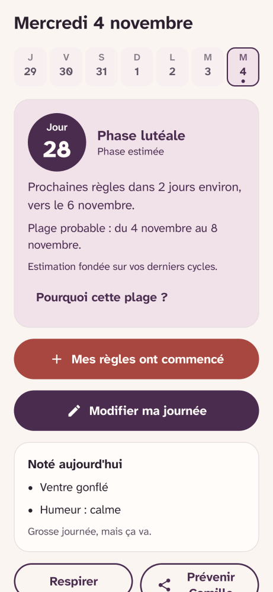
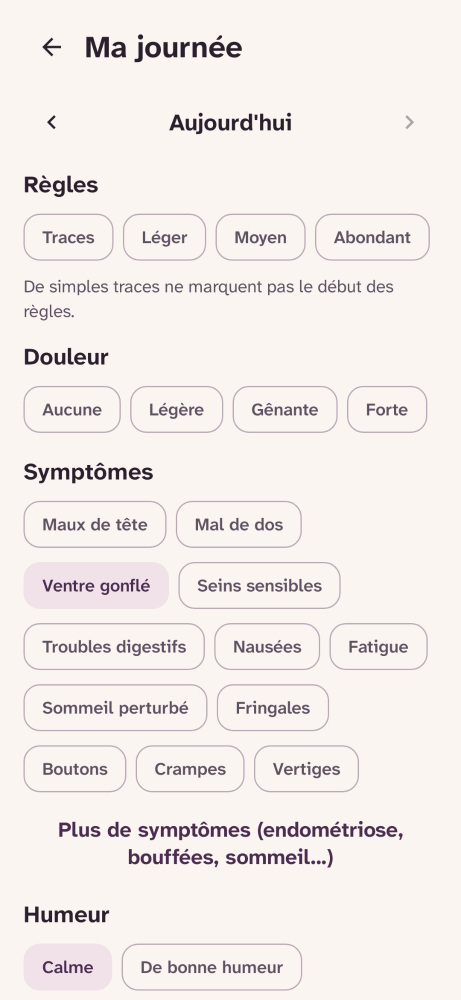
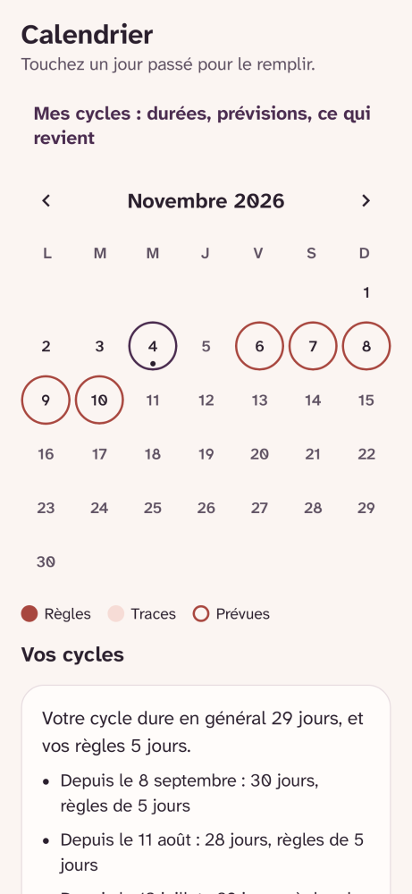
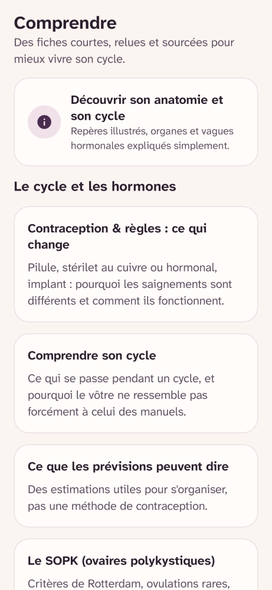
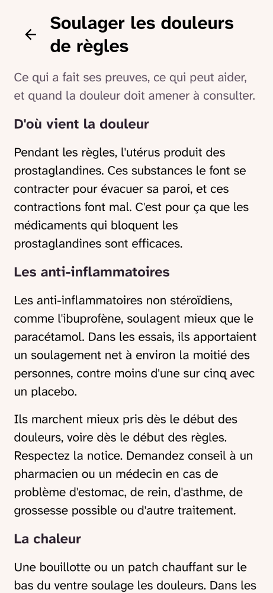
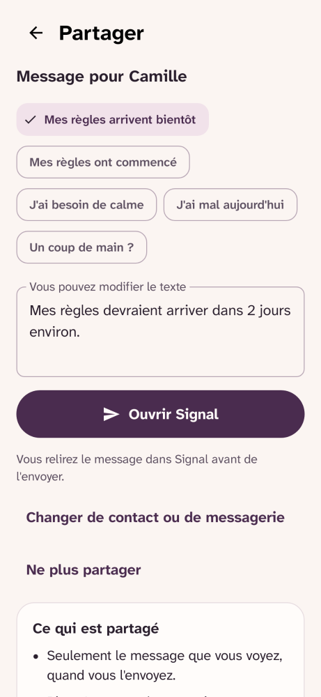
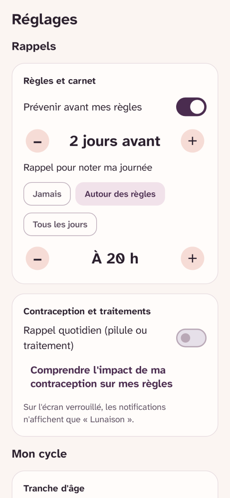
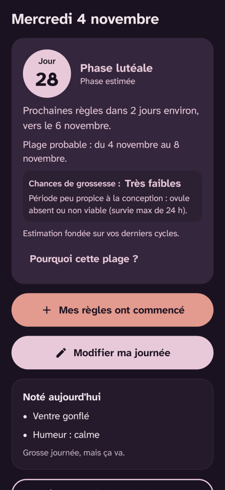
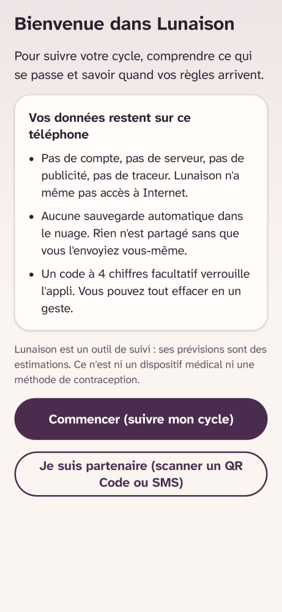

# Lunaison

**Français** · [English](README.en.md)

[](https://github.com/Relthdrarxash/lunaison/actions/workflows/ci.yml)

Suivi du cycle menstruel, libre et sans compte. Pour noter ses règles, ses symptômes et son humeur, comprendre ce qui se passe à chaque phase, savoir quand arrivent les prochaines règles, et prévenir son ou sa partenaire si on le souhaite.

Lunaison est une appli Android gratuite, libre (MPL-2.0), sans publicité, sans traceur et **sans accès à Internet**. Tout reste sur le téléphone.

**[Site de Lunaison](https://relthdrarxash.github.io/lunaison/)** · **[Google Play](https://play.google.com/store/apps/details?id=fr.lunaison)** · **[Télécharger l'APK](https://github.com/Relthdrarxash/lunaison/releases/latest)** · [Pour les professionnels de santé](https://relthdrarxash.github.io/lunaison/professionnels.html) · [Sources médicales](https://relthdrarxash.github.io/lunaison/sources.html) · [Confidentialité](https://relthdrarxash.github.io/lunaison/confidentialite.html)

## Ce que fait l'appli

- **Noter ses journées en quelques secondes** : flux, douleur (décrite par son effet), symptômes (8 symptômes courants affichés par défaut, plus symptômes cliniques dédiés aux douleurs pelviennes, à l'endométriose et à la périménopause), humeurs, prise de contraception ou de traitement, signes d'ovulation facultatifs (glaire cervicale et température basale sans clavier), note personnelle. **Ruban des 7 derniers jours sur l'accueil** pour visualiser ses journées récentes et compléter un jour oublié en un tap.
- **Prévoir les règles et s'adapter à chaque étape de vie** : une date estimée et une plage plausible calculées sur les six derniers cycles, avec option pour afficher la fenêtre fertile estimée, mode **cycles naturellement irréguliers** (périménopause, SOPK, post-partum) et possibilité de mettre les prévisions en pause (grossesse, allaitement, contraception continue).
- **Comprendre la phase en cours et les quatre phases** : ce qui se passe dans le corps, ce qui aide, et ce qui revient chez soi pendant chacune des quatre phases d'après les cycles précédents.
- **Générer un bilan sur une page pour un soignant** : accessible en un tap depuis l'onglet Calendrier ou les réglages. Durée médiane et régularité des 6 derniers cycles (repères FIGO/ACOG), durée des règles, jours de douleur modérée ou forte, saignements hors règles, **repères douleurs et endométriose sur 90 jours (les 5 « D »)** et symptômes récurrents, prêt à montrer ou partager en consultation.
- **Un conseil sourcé par jour et une minute de respiration guidée** : le conseil change chaque jour selon la phase et répond en priorité à ce qui a été noté ; un exercice de respiration abdominale (4 s / 6 s) aide à relâcher les crampes ou la tension prémenstruelle.
- **Repérer ce qui mérite un avis médical** : douleurs fortes répétées, règles de plus de 8 jours, règles abondantes répétées (repères du NHS), cycles hors des repères, saignements entre les règles, absence de règles, retard prolongé. Jamais un diagnostic.
- **Lire des fiches sourcées** : cycle, douleurs, alimentation, syndrome prémenstruel, quand consulter, contraception, **endométriose, SOPK, adénomyose, périménopause**, limites des prévisions, fiche pour l'entourage.
- **Migration et import de données sans serveur** : import direct des sauvegardes de l'application *Calendrier des règles* (archives ZIP protégées par mot de passe ou JSON) et fichiers CSV Lunaison, analysés et reconstitués en local sans envoyer le moindre octet sur Internet.
- **Rappels discrets** : avant les règles, pour noter sa journée, ou chaque jour pour sa contraception ou son traitement, toujours neutres sur l'écran verrouillé (« Lunaison »).
- **Partager avec un ou une partenaire, par message ou par QR Code** (18 ans et plus) : préparation de messages dans la messagerie choisie, conseils de soutien concrets pour le ou la partenaire, et partage direct des estimations par **QR Code** (affiché et scanné dans l'appli) ou par le menu de partage d'Android (SMS, Signal, WhatsApp…), d'un téléphone à l'autre sans passer par un serveur.
- **Personnalisation, code PIN et widget d'accueil** : 4 palettes de couleurs (clair et sombre), verrouillage facultatif par code à 4 chiffres (avec masquage dans les applications récentes) et widget d'accueil discret.

Lunaison n'est **ni un dispositif médical ni une méthode de contraception**.

## Aperçu

<table>
  <tr>
    <td align="center"><br>Accueil</td>
    <td align="center"><br>Ma journée</td>
    <td align="center"><br>Calendrier</td>
  </tr>
  <tr>
    <td align="center"><br>Comprendre</td>
    <td align="center"><br>Fiche sourcée</td>
    <td align="center"><br>Partage partenaire</td>
  </tr>
  <tr>
    <td align="center"><br>Réglages</td>
    <td align="center"><br>Thème sombre</td>
    <td align="center"><br>Bienvenue</td>
  </tr>
</table>

Les captures sont générées automatiquement à partir du code des écrans à chaque modification.

## Parti pris

- **Pas de permission Internet** : l'application ne demande aucun accès réseau à Android. Vos dates de règles, symptômes et notes restent sur votre téléphone.
- **Tout est inclus d'emblée** : le mode périménopause, le bilan de consultation, les signes d'ovulation et le partage partenaire sont accessibles sans abonnement.
- **Un ton posé, sans couleur rouge** : un retard ou un symptôme inhabituel est expliqué simplement avec ses références médicales.
- **Aucun compteur de régularité** : oublier de noter quelques jours est normal et n'empêche pas l'application de fonctionner.

## Pourquoi Lunaison est gratuite

Lunaison est née d'un besoin de ma compagne : suivre son cycle plus facilement, et me permettre de l'accompagner au quotidien. Les applications existantes réservent souvent leurs fonctions utiles à un abonnement, ou se financent avec les données de leurs utilisatrices, alors que ce sont parmi les plus intimes qui soient. Lunaison fait l'inverse : elle est gratuite, libre, fonctionne sans Internet et garde tout sur le téléphone.

L'appli reste au strict nécessaire. Ce qu'elle ne dit pas elle-même, d'où viennent ses repères et pourquoi elle est faite ainsi, est expliqué dans [Sources et choix de conception](https://relthdrarxash.github.io/lunaison/sources.html).

## Vie privée

- Aucune permission Internet, aucun SDK tiers, aucun compte.
- Sauvegarde dans le nuage désactivée : les données de santé ne passent par aucun serveur. Le transfert direct vers un nouveau téléphone (Android 12 et plus) reste possible, ainsi que l'export et l'**import direct de sauvegardes (fichiers CSV Lunaison ou archives chiffrées de l'application Calendrier des règles)**, traité 100 % localement.
- Le sélecteur de contacts du système donne accès au seul contact choisi, sans autorisation sur le carnet d'adresses.
- Effacement complet en un geste.

## Technique

Kotlin, Jetpack Compose, Material 3, Room, WorkManager. minSdk 26, targetSdk 36.

L'appli est en français et en anglais, selon la langue du téléphone. Chaque texte est écrit dans les deux langues côte à côte (fonction `tr` de `:core:model`), pour qu'aucune traduction ne puisse manquer ; les fiches ont un fichier par langue, vérifié par les tests.

```
:app                 Écrans, navigation, rappels, widget
:ui                  Composants d'interface (Accueil, Ma journée, Calendrier, Comprendre, Partage, Réglages)
:core:model          Journée notée : flux, douleur, symptômes, humeurs (pur Kotlin)
:core:cycle          Moteur : repérage des règles, prévision, phases, signaux, rappels (pur Kotlin, testé)
:core:content        Fiches, conseils par phase, messages de partage, sources (pur Kotlin, testé)
:core:data           Base Room locale, migrations non destructives et dépôt unique
:core:designsystem   Thème, 4 palettes WCAG AA, police Atkinson Hyperlegible, composants accessibles
```

Les règles du moteur et leurs références sont dans [`CycleConfig.kt`](core/cycle/src/main/kotlin/fr/lunaison/core/cycle/CycleConfig.kt). Les sources des contenus et les choix de conception sont dans [documentation/sources.md](documentation/sources.md), publié sur le site : [Sources et choix de conception](https://relthdrarxash.github.io/lunaison/sources.html). Après une modification, régénérer la page avec `python3 scripts/site-sources.py`.

Tests : `./gradlew test`. Construction : `./gradlew :app:assembleDebug`.

## Du même atelier (Pilmil Studio)

- **[Sommelle](https://github.com/Relthdrarxash/sommelle)** : accompagnement de l'insomnie chronique par la TCC-I en 6 à 8 semaines, gratuit, libre et sans accès à Internet.
- **[Respire](https://github.com/Relthdrarxash/respire)** : une courte pause de respiration avant les applications que l'on ouvre par réflexe, avec filtre des Reels et Shorts.
- **[Sauve](https://github.com/Relthdrarxash/sauve)** : premiers secours « anti-panique », gratuit, libre et sans accès à Internet, avec guidage vocal et haptique mains libres.
- **[Sillon](https://github.com/Relthdrarxash/sillon)** : potager vivant et calendrier agronomique indexé sur la date des dernières gelées, gratuit, libre et sans accès à Internet.

## Pistes envisagées

Les fonctions étudiées mais pas encore réalisées, comme l'import de l'historique depuis d'autres applications, sont décrites dans [documentation/pistes.md](documentation/pistes.md).

## Contact et licence

Contact : [pilmil.studio@proton.me](mailto:pilmil.studio@proton.me). Distribuée sous licence [Mozilla Public License 2.0](LICENSE) (MPL-2.0) : vous pouvez l'utiliser, l'étudier, la modifier et la redistribuer ; les fichiers que vous modifiez doivent rester publiés sous la même licence, avec leur code source.

## Note sur le développement

Le code de Lunaison a été développé avec l'aide d'un assistant IA (Claude, d'Anthropic) : l'application elle-même n'embarque aucune intelligence artificielle, tous les contenus de santé sont rédigés et vérifiés à partir des sources publiques (HAS, NHS, CNGOF, INSERM), le moteur du cycle est purement déterministe et couvert par des tests automatiques, et je maintiens personnellement le projet en répondant moi-même aux tickets et aux messages.
